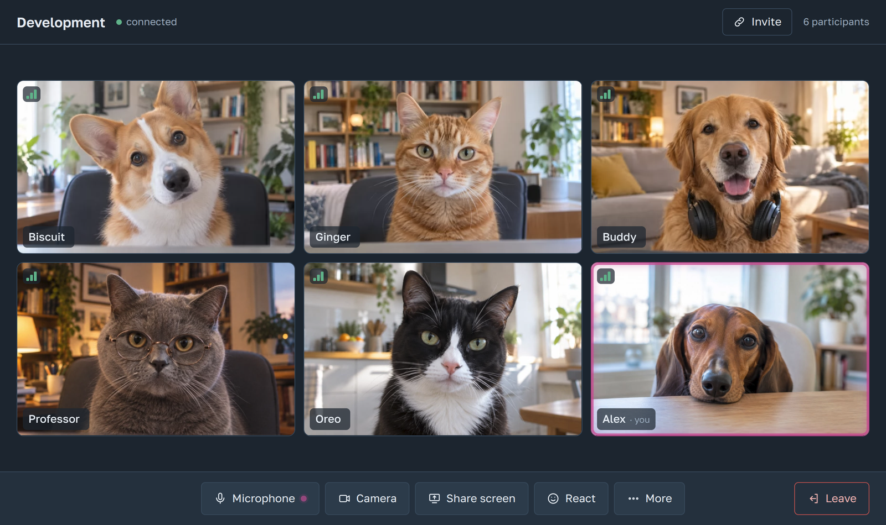
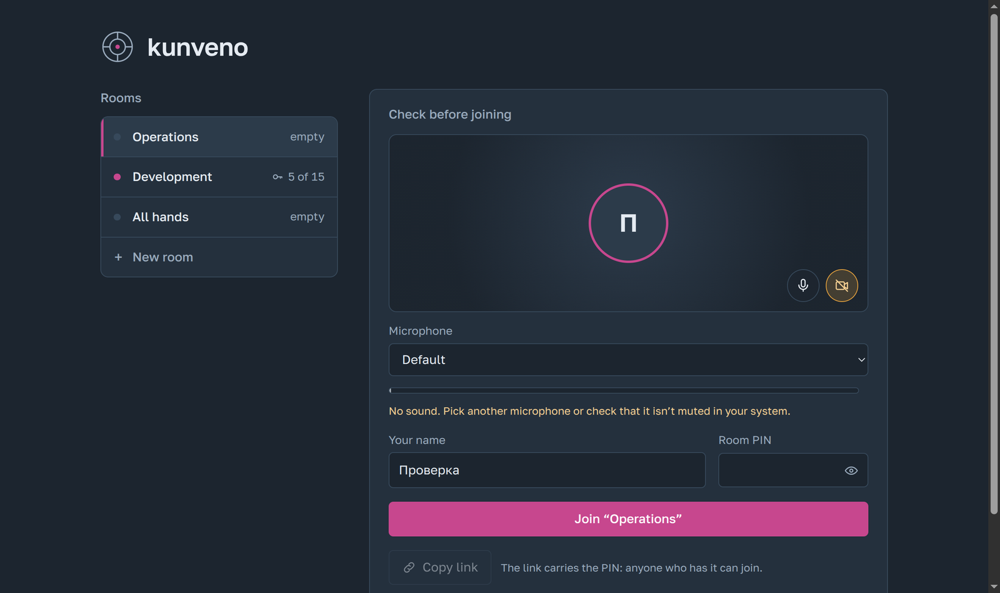

# kunveno

English · [Русский](README.ru.md) · [Español](README.es.md)

Self-hosted video meetings for a company network: voice, cameras and screen sharing in the
browser, with a small Go server you run yourself. Esperanto: "meeting".

Built for an office or VPN where you want calls without third-party services: no accounts, no
STUN or TURN servers, no CDN, no analytics. A room is a name and a PIN; everything runs on one
host behind nginx.

Licensed under the GNU Affero General Public License v3.0 only; a commercial license is available
(see [License](#license)).



## Features

- Rooms with a PIN, defined in the configuration or created from the lobby (persisted on the
  host). Up to 50 people per room (15 by default).
- Audio from everyone, cameras (640x360, 15 fps), one shared screen at a time.
- A pre-join check: microphone and camera choice, a level meter, and entering with the
  microphone or camera off. Works on computers without a camera.
- Virtual backgrounds, processed in the browser: blur, glass blocks, images the administrator puts
  in `backgrounds/`, or your own image that never leaves the browser. Noise suppression for the
  microphone (keyboard clicks, background sounds), also in the browser.
- Links to a room (`https://<host>/join/<room>#pin=…`), copied from the lobby or from inside a
  room: the recipient lands in the pre-join check with the room and PIN filled in. The PIN sits
  in the fragment, which the browser keeps to itself: it never reaches the server or its logs.
- A connection-quality indicator on every participant (loss, round trip and jitter, measured
  on the server).
- An echo sound check per room, rooms that play a video file in a loop, and rooms that show a
  live RTSP camera.
- Meeting notes with the commercial `kunveno-notes` add-on: each participant's speech is recognised
  on the server, and the text of a room's last meeting is downloaded as Markdown (see
  [Meeting notes](#meeting-notes)).
- Meeting recording with the commercial `kunveno-recorder` add-on: the shared screen and everyone's
  audio as one MP4 video, downloaded from the room or the lobby (see
  [Meeting recording](#meeting-recording)).
- Works behind awkward networks: when a participant's UDP path fails, the browser falls back to
  ICE over TCP on the same port.
- Interface in Russian (default), English and Spanish; the installation title is configurable.
- Protection against PIN guessing, Prometheus metrics with a Grafana dashboard, logs in the host
  journal.



## Setup

You need a Linux server with Docker that your users can reach over the network.

**1. Download and unpack** the stack:

```bash
curl -fsSL https://github.com/ssubbotin/kunveno/releases/latest/download/kunveno.tgz | tar xz
cd kunveno
```

The services run as user 10001, never as root. What they write (rooms created in the lobby, notes,
recordings) lives in the Docker volume `kunveno_data`; the files here only need to be readable, as
files normally are (`config.yaml`, and what you add to `media/` and `backgrounds/`).

The directory is the whole installation:

```
docker-compose.yml
Makefile        make up (start or update), make down (stop), make pull
.env            settings: fill in two lines, the rest is optional
config.yaml     rooms, PINs and the title; the defaults work as they are
certs/          TLS certificate: self-signed on first start, or your own
backgrounds/    images offered as virtual backgrounds
media/          video files for rooms with a player
grafana/        Grafana's data source and dashboard
```

**2. Fill in two lines in `.env`:**

```bash
PUBLIC_HOST=10.0.0.5            # the server's address or name, as users type it in the browser
GRAFANA_ADMIN_PASSWORD=...      # any strong password; generate one with: openssl rand -base64 24
```

**3. Start:**

```bash
make up
```

**4. Open `https://<PUBLIC_HOST>/`** and join a room with its PIN from `config.yaml`. The
certificate is self-signed, so each browser asks to accept it once.

**5. Open the firewall** to your users: TCP 443 (web) and port 7000 over UDP and TCP (audio and
video).

### Everyday tasks

| Task | How |
|---|---|
| Apply changes to `config.yaml` | `docker compose restart server player` |
| Read the logs | `journalctl -t kunveno-server -f` |
| Monitoring | `https://<PUBLIC_HOST>/grafana/`, user `admin`, the password from `.env`. On a server that faces the internet set `GRAFANA_WALL_PASSWORD` in `.env`: the browser then asks for it (user `GRAFANA_WALL_USER`, default `admin`) before Grafana's login |
| Use your own certificate | replace `certs/fullchain.pem` and `certs/privkey.pem`, then `docker compose restart web` |
| Stop | `make down`: the containers go, the volumes (rooms, notes, recordings) stay. `docker compose down -v` would delete them |
| Back up | copy the directory, and the data volume: `docker run --rm -v kunveno_data:/d -v "$PWD":/b alpine tar czf /b/data.tgz -C /d .` |

**Upgrade** to a new release, in the directory:

```bash
make up
```

The stack runs the `latest` images, so this fetches the new release and restarts only the
containers whose image changed; `.env`, `config.yaml` and the data stay. To stay on one release,
set `KUNVENO_VERSION=0.2.4` (for example) in `.env`.

**Coming from a release before 0.4.5** (the services ran as root and kept their data in `./data`):
take the new stack files, start, and import the old data once:

```bash
curl -fsSL https://github.com/ssubbotin/kunveno/releases/latest/download/kunveno.tgz | tar xz --strip-components=1 kunveno/docker-compose.yml kunveno/Makefile
make up && make import-data && make up
```

### If something does not work

- **Users join but hear and see nothing:** the server guessed the wrong address for media. Add
  `KUNVENO_ADVERTISE_IP=<the address users reach, e.g. the VPN one>` to `.env` and run
  `make up`.
- **Ports 80 or 443 are taken:** set `HTTP_PORT` and `HTTPS_PORT` in `.env`.
- **The server stops with "permission denied" on `config.yaml`:** it runs as user 10001 and must be
  able to read the file: `chmod 644 config.yaml`.
- **The server stops with "config.yaml is a directory":** the file went missing and Docker created
  a directory in its place; remove the directory, restore `config.yaml` from the archive and start
  again.

All `.env` settings are described in `.env` itself, all `config.yaml` settings in
[Configuration](#configuration). Certificates, the firewall, troubleshooting and the Debian packages
are in [docs/deploy.md](docs/deploy.md).

## For administrators

**Where the media goes.** kunveno is a selective forwarding unit (SFU): every participant sends
the server one stream per kind (voice, camera, screen) and the server sends copies to everyone
else. Nothing travels between participants directly, so each participant's upstream stays small
and the load lands on the server's network link.

**Encryption.** Media is encrypted with DTLS-SRTP between each browser and the server, so on the
wire everything is encrypted. The server decrypts the streams to forward them; there is no
end-to-end encryption between participants. The site and signaling go over HTTPS.

**Bandwidth.** Per participant, roughly: voice about 40 kbit/s, a camera about 350 kbit/s, screen
sharing up to 2.5 Mbit/s (`media.share_max_kbps`). The server receives one stream of each kind
from every participant and sends (N − 1) copies of each. For 15 people with cameras on and one
screen shared that is about 120 Mbit/s outbound from the server in the worst case; a voice-only
meeting of the same size needs under 10 Mbit/s.

**Ports.** Everything runs on the one host:

| Port | What it carries |
|---|---|
| TCP 443 | the site (HTTPS) and signaling (WebSocket through nginx) |
| TCP 80 | a redirect to 443, nothing else |
| UDP 7000 | the media channel: voice and video of all participants on one port; no per-call ports are opened |
| TCP 7000 | the fallback media channel for a participant whose UDP does not get through (typically a NAT or a firewall on a gateway that drops long UDP flows); the browser switches to it on its own and keeps it for a week, and "try the fast one" next to the status switches back |

No STUN, TURN or other external service is involved. The server's own ports (API, metrics,
Prometheus, Grafana, node-exporter) listen on 127.0.0.1 only; Grafana is reached through 443 at `/grafana/`.
The dashboard's "Заметки" row (collapsed) belongs to the optional kunveno-notes add-on, which adds its
Prometheus target through `/etc/prometheus/targets/*.json`; without it there is no target and the row is empty.
The "Запись" row (collapsed) works the same way for the kunveno-recorder add-on.

**Firewall rule.** Allow from your users' networks to the host: TCP 443 (and 80), UDP 7000 and
TCP 7000. If a network segment can only use TCP 7000, letting its UDP 7000 through gives those
users the faster path.

**Screen sharing** is the browser's own feature (`getDisplayMedia`); nothing is installed on
users' computers. It works in Chrome and Firefox on Linux and Windows.

## Meeting notes

A participant can switch on notes in a room (More → Take notes). The notes bot then joins the room
as a participant named "Notes", listens to each person's microphone separately and sends the
recognised phrases to the server, which keeps the text: who said what, and when. Everyone in the
room sees "Notes" with a sheet icon in the header. When the notes are switched off, or the last
person leaves, everyone still in the room gets the bar "Ready after the meeting:" with a "Notes"
button that downloads them; the lobby offers the same file under "Last meeting", with the room PIN. The file is Markdown: the room,
the date and time, who spoke, and the phrases in order, with pauses marked.

- The bot is the commercial add-on `kunveno-notes` (speech recognition on the server's processor,
  no external service, no audio stored). It is not part of this repository; for a licence write to
  ssubbotin@gmail.com. Its installation guide comes with the licence.
- Without the add-on keep `notes.enabled: false` (the default): rooms and the lobby show nothing
  about notes.
- Only the last meeting of each room is kept, for `notes.keep` (one day by default) after its notes
  end (a switch-off or the end of the meeting); the first phrase of the next meeting replaces it.
  Deleting a room deletes its notes. Downloading needs the room PIN, and wrong PINs count toward
  the same block as joins.
- The notes can be deleted earlier from the lobby: "Last meeting" → "Delete…" with the room PIN,
  then "Notes" (or "Everything") in the confirmation. Notes still being taken cannot be deleted: switch them
  off first.
- `notes.live: true` shows the phrases in the room as they are recognised, in the tile of the
  "Notes" participant, for checking the recognition.

## Meeting summary

With `notes.summary: true` (and notes on) each meeting whose notes were taken also gets a short
summary: what happened, the decisions, the action items with who does them and the open questions,
and a line per person when people take turns reporting. It is written by the summary service of the
`kunveno-notes` add-on with a language model (LLM) you set up there, usually a local one (any server
with an OpenAI-compatible API, such as vLLM or ollama).

- The summary appears next to the notes in the lobby's "Last meeting" dialog about a minute after the
  meeting ends. Until then it reads "being prepared", and "could not be written" when the model
  failed.
- It is kept with the notes and goes with them: the same `notes.keep`, the same PIN to download, and
  deleting the notes or the room deletes it. Only the last meeting of each room has one.
- The summary alone can be deleted in the same dialog: the notes stay, and no new summary is written
  for them.
- It is written automatically and may contain mistakes, mostly in names and terms the recognition
  garbled; the file says so, and the notes stay next to it.
- The meeting's notes leave the server for the model you configured. Off by default.

## Meeting recording

A participant can switch on recording in a room (More → Recording). The recorder bot then
joins the room as a participant named "Recording" and records the shared screen and everyone's audio
as one video (1920x1080, 15 frames per second, H.264 and AAC). While nobody shares a screen, the
video shows the current speaker's camera, or, when that camera is off, a slate with the room name,
the date and the speaker's name. Other cameras are not recorded.
Everyone in the room sees "● Recording" in the header; the red dot always means this video. When
recording is switched off, or the last person leaves, the bot uploads the file to the server, and
everyone still in the room gets a "Video" button in the bar "Ready after the meeting:" (next to
"Notes" when the meeting had notes too, with one close button for both); the lobby offers the same
file under "Last meeting", with the room PIN.

The lobby shows "Last meeting" under a room that keeps a video, notes or both, with what is there
and the nearest expiry ("Video and notes, kept until 10/16, 2:43 PM"). Its dialog asks for the room
PIN once and lists each item with its own expiry and a "Download" button. Above the caption and in
the dialog the lobby also shows when that meeting took place, how long it lasted and how many people
took part ("10/15, 11:00 AM–11:27 AM · 27 min · 7 participants"; no names), while its notes or recording
are kept.

- The recorder is the commercial add-on `kunveno-recorder`. It is not part of this repository; for a
  licence write to ssubbotin@gmail.com. Its installation guide comes with the licence.
- Without the add-on keep `recording.enabled: false` (the default): rooms and the lobby show nothing
  about recording.
- Only the last meeting of each room is kept, for `recording.keep` (one day by default) after it
  ends; the next recording replaces it. Switching recording on again in the same meeting also replaces what
  was recorded before: a meeting has one recording, and the later one wins. Deleting a room deletes
  its recording. Downloading needs the room PIN, and wrong PINs count toward the same block as
  joins. An interrupted download can be resumed while its link is valid (5 minutes); afterwards start
  the download again from the room or the lobby.
- The recording can be deleted earlier from the lobby: "Last meeting" → "Delete…" with the room
  PIN, then "Video" (or "Everything") in the confirmation. A recording in progress cannot be deleted: switch it off first.
- A file larger than `recording.max_size` (8 GB by default) is refused by the server and stays in the
  add-on's volume, so size the limit for the longest meeting and keep free disk space for it.

## Sign-in and guests

Sign-in is optional. With `auth.enabled: false` (the default) everything works as before: anyone who
reaches the server sees the lobby. With `auth.enabled: true` only approved people get in, and
people from outside join one room by an invitation link. The first provider is Yandex ID; others
can be added later as separate packages.

- **Employees.** The lobby shows a sign-in screen with one button per provider. After sign-in the
  name comes from the account (cut to 32 characters) and the join message's name is ignored. The
  room PIN is still asked, with the same limit on wrong attempts. A session lasts `auth.session`
  (12 hours by default); when it expires the employee stays in the current meeting, reconnects
  included, and signs in again for the next one. A sign-in that fails comes back to the sign-in
  screen with the reason: cancelled in the provider's window, an account the `allow` list refuses,
  or a provider that is unavailable. A room link opened while signed out leads back to that room after
  sign-in, with the PIN filled. "Sign out" is in the lobby.
- **Who is approved.** A provider says who the person is. The provider's `allow` list decides whether to
  admit them. It holds patterns matched against the account's login, for example `*@example.com`. The
  login of an organization account in Yandex 360 is `name@example.com`; a personal Yandex account
  has a login without "@", whatever contact address it lists, so it is refused. Patterns are
  required: `*` alone is rejected.
- **Guests.** In a room an employee opens More → "Invite a guest", picks 1 hour, 24 hours (the
  default) or 7 days (never more than `auth.invite_max`, 168 hours by default), and copies the
  link `https://<host>/join/<room>#invite=<token>`. The guest enters a name and joins without an
  account and without the PIN, marked "guest" in the participant list. The token sits after `#`,
  so it reaches neither server logs nor a `Referer`; the server stores only its SHA-256.
  The same dialog lists the room's active links with "Revoke".
- **When access ends.** Revoking a link disconnects the guests who joined with it at once. An
  expired link admits no new guests; those already inside stay to the end of the meeting,
  reconnects included. Deleting a room ends its links.
- **What a guest cannot do.** Guests reach only the room of their link. They cannot see the
  lobby, switch recording, notes or the echo test, download notes or recordings, or create links.
  Recording and notes an employee switched on continue after the last employee leaves.
- **What sign-in protects.** Every `/api/` route except `/api/info` (it tells the page whether
  sign-in is on) and `/api/backgrounds` needs a session. Requests that change something must come
  from the page at `auth.public_url`. The session is a signed cookie (`__Host-kunveno`, `Secure`,
  `HttpOnly`); the key is the file `auth.key` next to `rooms_file`, so restarts keep sessions.
  Deleting it signs everyone out.
- **Helpers.** The echo, player, notes bot and recorder keep joining over loopback without
  sign-in; their contract is unchanged.

Setup in short (details, including registering the Yandex app, in [docs/deploy.md](docs/deploy.md)):

```yaml
auth:
  enabled: true
  public_url: https://meet.example.com   # https only; the callback is built from it
  providers:
    - type: yandex
      name: "Yandex 360"                 # the button's label
      client_id: "..."
      allow: ["*@example.com"]
```

The provider's secret goes into `.env` as `KUNVENO_AUTH_YANDEX_SECRET`, never into `config.yaml`.
The server refuses to start with sign-in on and no provider, no `public_url` or one that is not
`https://`, or a provider without a client ID, a secret or an `allow` list. Open the service at
the `public_url` address: sign-in and the request check work only there.

## How it works



- `kunveno-server` (Go, [pion/webrtc](https://github.com/pion/webrtc)) is a selective forwarding
  unit: each participant sends one stream per kind (audio, screen, camera) and the server forwards
  it to everyone else. ICE runs in lite mode with a single host candidate (`media.advertise_ip`),
  one UDP port for all media and the same port on TCP as a fallback.
- Each browser keeps one `RTCPeerConnection` with three fixed send slots (audio, screen, camera);
  turning a camera or share on or off swaps the track without renegotiation. The server is the
  only SDP offerer.
- The web client (Svelte 5, Vite, TypeScript) is a static bundle served by nginx, which also
  terminates TLS and proxies `/ws` and `/api/` to the server on loopback.
- `kunveno-echo` and `kunveno-player` are helpers that join rooms as participants over loopback:
  the echo plays a room's sound back with a delay when someone asks for it; the player either plays
  a configured video file in a loop or relays a live RTSP camera, as its own camera tile (a live
  feed is marked as such). It uses ffmpeg: a file is transcoded once to VP8 and Opus and
  cached, a feed is transcoded on the fly and reconnected every 5 s if it drops.

Certificates, the firewall, troubleshooting and the helpers in detail: [docs/deploy.md](docs/deploy.md).

## Repository layout

| Path | What |
|---|---|
| `cmd/kunveno-server` | server process: configuration, HTTP, signaling, media |
| `cmd/kunveno-echo`, `cmd/kunveno-player` | the echo, and the player for video files and RTSP cameras |
| `internal/room`, `internal/conference`, `internal/signal`, `internal/sfu` | room state, meetings, WebSocket signaling, the SFU |
| `internal/config`, `internal/httpapi`, `internal/metrics` | configuration, HTTP API, Prometheus metrics |
| `internal/quality`, `internal/ratelimit`, `internal/roomstore` | connection grades, PIN limits, saved rooms |
| `internal/echo`, `internal/player`, `pkg/botclient` | helper internals |
| `web/` | the browser client |
| `deploy/` | Docker images and compose stack, nginx, systemd unit, deb packaging, example configuration |
| `tools/loadgen` | synthetic participants for load and end-to-end checks |
| `docs/` | operations guide, manual checks before a release, the architecture diagram and screenshots |

## Development

Requirements: Go 1.26, Node 22, and ffmpeg for the player's tests (skipped without it).

```bash
make test        # go vet + go test -race, and the web client's tests
make build       # bin/kunveno-server and web/dist
make fmt         # gofmt + go mod tidy

go test ./internal/sfu -run TestCameraFlowsBetweenTwoPeers -v    # one Go test
cd web && npx vitest run src/lib/pins.test.ts                    # one web test file
cd web && npm run check                                          # svelte-check
```

Running locally: copy `deploy/kunveno/config.yaml`, set `media.advertise_ip` to the machine's LAN
address (browsers gather no loopback candidates, so `127.0.0.1` gives no media), start
`bin/kunveno-server -config <file>`, then `cd web && npm run dev` (Vite proxies `/ws` and `/api/`
to `127.0.0.1:8080`). `go run ./tools/loadgen -n 14 -duration 30s` adds synthetic participants (`-camera <picture or
directory>` gives them cameras showing still pictures, `-names a,b,c` names them; needs ffmpeg). Before a release, walk
through the manual checks in [docs/test-matrix.md](docs/test-matrix.md).

## Configuration

`config.yaml` (read at start; the server refuses unknown keys):

| Key | Meaning |
|---|---|
| `http.listen` | address nginx proxies to, on loopback (default `KUNVENO_UPSTREAM` from `.env`, else `127.0.0.1:8080`) |
| `media.advertise_ip` | the address browsers send media to (default `KUNVENO_ADVERTISE_IP` from `.env`, else the host's primary IPv4 address) |
| `media.udp_port`, `media.tcp_port` | media ports (7000 by default; `tcp_port: -1` turns the TCP fallback off) |
| `media.share_max_kbps` | bitrate cap for screen sharing |
| `media.reconnect_grace` | seconds a client waits on a dropped media connection before it rejoins (3..120; 15 by default). Outages shorter than this freeze the audio and the video (cameras, the shared screen) |
| `ui.title` | title shown in the lobby and the browser tab |
| `ui.reactions` | emoji participants can send as reactions (1..16; ten by default) |
| `ui.noise_suppression` | `true` turns the client's noise filter (GTCRN) on for participants who have not chosen themselves (default `false`) |
| `rooms[]` | `slug`, `name`, `pin`, `max_participants`, and optionally `player: {file, name}` for a video loop from the media directory or `player: {url, name}` for a live camera (`rtsp://` or `rtsps://`, credentials in the URL are masked in logs) |
| `rooms_file` | where rooms created in the lobby are saved (`/var/lib/kunveno/rooms.json`) |
| `backgrounds_dir` | folder with the virtual background images (`/var/lib/kunveno/backgrounds`; the stack mounts `backgrounds/` there) |
| `notes.enabled` | `true` offers meeting notes in rooms; needs the `kunveno-notes` add-on (default `false`, which hides every notes control) |
| `notes.keep` | how long notes stay after they end: a whole number and `m`, `h` or `d` (`90m`, `12h`, `1d`, `2d`; default `1d`) |
| `notes.live` | `true` shows phrases in the room as they are recognised, for checking the recognition (default `false`) |
| `notes.summary` | `true` offers a summary of each meeting's notes next to them, written by the add-on's summary service with an LLM; needs `notes.enabled` (default `false`) |
| `notes.dir` | where the notes are kept (`/var/lib/kunveno/notes`, in the stack's data volume) |
| `recording.enabled` | `true` offers meeting recording in rooms; needs the `kunveno-recorder` add-on (default `false`, which hides every recording control) |
| `recording.keep` | how long a recording stays after it ends: a whole number and `m`, `h` or `d` (`90m`, `12h`, `1d`, `2d`; default `1d`) |
| `recording.dir` | where recordings are kept (`/var/lib/kunveno/recordings`, in the stack's data volume) |
| `recording.max_size` | the largest recording the server accepts: a whole number and `MB` or `GB` (`500MB`, `8GB`; default `8GB`) |
| `auth.enabled` | `true` turns sign-in on (default `false`: no sign-in, as before) |
| `auth.public_url` | the address people open, `https://` only; the provider's callback `<public_url>/auth/<type>/callback` is built from it |
| `auth.session` | how long a sign-in lasts, a Go duration (`12h` by default, 1m to 720h) |
| `auth.invite_max` | the longest guest invitation (`168h` by default, 1h to 720h) |
| `auth.providers[]` | `type` (`yandex`), `name` (the button's label), `client_id`, `allow` (login patterns such as `*@example.com`); the secret is `KUNVENO_AUTH_<TYPE>_SECRET` in `.env` |

`.env` next to the compose file sets the release (`KUNVENO_VERSION`), ports, the public host name
for Grafana and its admin password.

## Operations

- Logs: `journalctl -t kunveno-server --since "7 days ago" -o cat` (also `kunveno-web`,
  `kunveno-echo`, `kunveno-player`, `kunveno-prometheus`, `kunveno-grafana`, `kunveno-node-exporter`). Each connection logs
  its media path (UDP or TCP), quality changes and wrong PINs.
- Metrics: `/metrics` on the server (loopback only); Grafana at `https://<host>/grafana/` with the
  provisioned "kunveno" dashboard.
- Data to keep: next to `docker-compose.yml` `config.yaml`, `.env`, `certs/` and `media/`; and the
  Docker volume `kunveno_data` (rooms created in the lobby, notes, recordings, the player's cache).
- An RTSP camera must be reachable from the host; the player pulls it over TCP. A room whose feed is
  down keeps the player as a participant without video until the feed returns.

## Versions

Releases are git tags `vX.Y.Z` on merge commits to `main`; the version shows in the lobby footer
and in the `kunveno_build_info` metric. A tag publishes the images
`ghcr.io/ssubbotin/kunveno-{server,web,echo,player}` as `X.Y.Z` and `latest` and a GitHub
release with `kunveno.tgz`, the stack directory with `docker-compose.yml` pinned to that
version. `main` publishes `main`, and a pull request from this repository publishes a
preview `pr-<number>` (`KUNVENO_VERSION=pr-<number>` in `.env` to try it).

## License

Copyright (C) 2026 Sergey Subbotin <ssubbotin@gmail.com>

kunveno is free software: you can redistribute it and/or modify it under the terms of the
[GNU Affero General Public License, version 3](LICENSE) (`AGPL-3.0-only`). In short: you may run,
study, change and share it; if you run a modified version as a network service, you must offer its
users the source of that version.

A commercial license is available for organizations that cannot accept the AGPL terms, for
example to ship kunveno inside a proprietary product, to keep their changes private, or to offer
kunveno as a hosted or resold service without publishing their changes. Commercial terms also
cover support. Write to ssubbotin@gmail.com.

The name "kunveno" identifies the original project; forks should use a different name.
